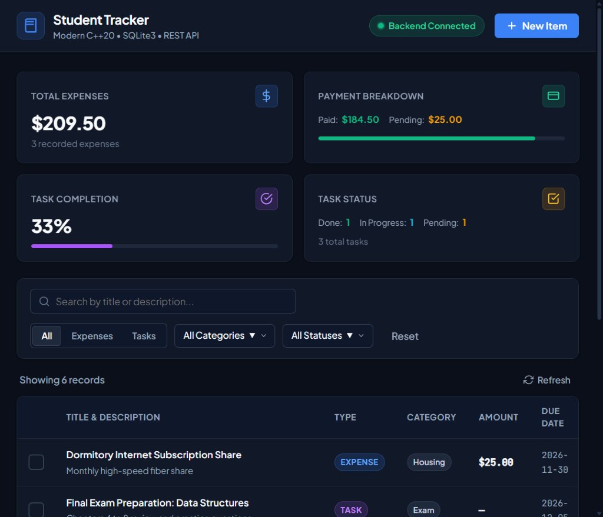
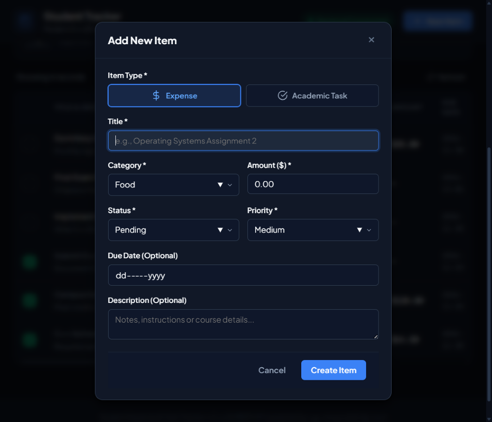
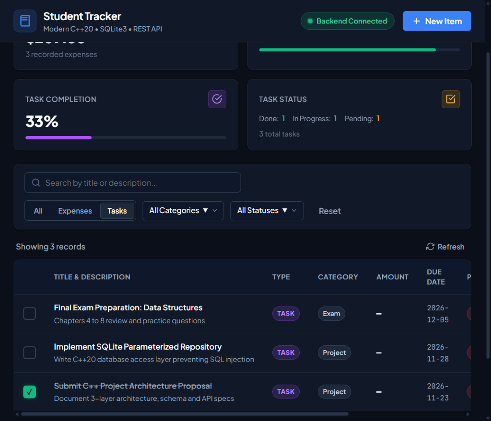
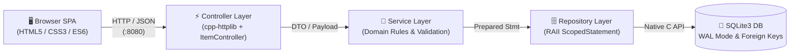

# 🎓 Student Expense & Task Tracker

[](https://en.cppreference.com/w/cpp/20)
[](https://www.sqlite.org/)
[](https://cmake.org/)
[](https://opensource.org/licenses/MIT)
[](https://github.com/m4ulikP/cpp-sqlite-tracker)
[](#prerequisites--setup)

A high-performance, full-stack application built with **Modern C++20**, **SQLite3 (WAL Mode)**, and a responsive **Obsidian Dark Web Dashboard**. Designed to track academic milestones (assignments, labs, exams) and expenses (rent, tuition, books, daily spending) in a single unified interface with real-time summary analytics.

---

## 📑 Table of Contents

- [✨ Key Features](#-key-features)
- [📸 Live Visual Preview](#-live-visual-preview)
- [🏛️ System Architecture](#️-system-architecture)
- [📁 Project Directory Structure](#-project-directory-structure)
- [🛠️ Prerequisites & Setup](#️-prerequisites--setup)
- [🚀 Running the Application & Demo Flow](#-running-the-application--demo-flow)
- [📡 REST API Specification](#-rest-api-specification)
- [🧪 Automated Test Suites](#-automated-test-suites)
- [🛡️ Security & Hardening Notes](#️-security--hardening-notes)
- [📜 License](#-license)

---

## ✨ Key Features

- **Strict Three-Layer Separation:** Complete decoupling of HTTP routing, business logic validation, and raw SQL persistence.
- **Modern C++20 Standard:** Leverages `<filesystem>`, structured bindings, `std::optional`, designated initializers, and RAII scoped resources.
- **Robust SQL Security:** Zero string-concatenated SQL queries. 100% prepared statements (`sqlite3_prepare_v2`) with bound parameters (`sqlite3_bind_*`).
- **High-Concurrency SQLite Storage:** Configured with Write-Ahead Logging (`PRAGMA journal_mode = WAL;`) and enforced Foreign Keys (`PRAGMA foreign_keys = ON;`).
- **Standardized JSON REST API:** Envelope responses (`{ "success": bool, "data": ..., "error": ... }`) with granular domain error codes.
- **Cohesive Obsidian Dark UI:** Clean dark aesthetic (`#0b0f19` canvas, `#111827` cards) with spring-physics transitions (`cubic-bezier(0.22, 1, 0.36, 1)`), custom themed scrollbars, and accessible text selection highlights.
- **Embedded Static Server:** Single binary delivery (`tracker_server.exe`) serving both the backend REST API and the frontend single-page application on `http://localhost:8080`.

---

## 📸 Live Visual Preview

### 1. Main Dashboard (Dark Mode & Summary Metrics)
The responsive dashboard calculates aggregate metrics in real time via `GET /api/items/summary` and lists records with status chips, priority chips, and action buttons:



### 2. Create & Edit Modal Dialog
Clean modal form with responsive type-switching between **Expense** (with amount field) and **Task** (with due date and priority):



### 3. Filtered Records View
Fast client-side tab switching and backend-filtered queries (`type`, `status`, `category`, and full-text `search`):



---

## 🏛️ System Architecture

The application is structured into three clean, decoupled layers with strict one-directional data flow:



| Layer | Core Component | Role & Responsibilities |
|---|---|---|
| **Presentation** | Web Dashboard & `ApiClient` | Responsive single-page UI; communicates via `fetch()` with standardized JSON payloads. |
| **Controller** | `ItemController` (`cpp-httplib`) | Routes REST endpoints, enforces CORS, decodes requests, and wraps standardized JSON responses (`{ success, data, error }`). |
| **Service** | `ItemService` | Validates domain business rules (field requirements, value bounds) and returns typed `ServiceResult<T>`. |
| **Repository & DB** | `ItemRepository` & `DatabaseManager` | Manages SQLite connection via RAII, runs parameterized prepared statements (`sqlite3_bind_*`), and executes schema migrations. |

---

## 📁 Project Directory Structure

```
cpp-sqlite-tracker/
├── .gitignore                    # Ignores build artifacts, sqlite journals, temp files
├── CMakeLists.txt                # Cross-platform CMake 3.20+ build definition
├── README.md                     # Comprehensive project documentation
├── backend/
│   ├── include/
│   │   ├── controllers/
│   │   │   └── ItemController.hpp # REST route registration and JSON mapping
│   │   ├── db/
│   │   │   └── DatabaseManager.hpp# SQLite connection lifecycle & schema setup
│   │   ├── models/
│   │   │   └── Item.hpp           # Item & Summary structs, JSON serialization
│   │   ├── repository/
│   │   │   └── ItemRepository.hpp # SQL CRUD interface & ScopedStatement RAII
│   │   └── services/
│   │       └── ItemService.hpp    # Business validation & ServiceResult<T>
│   ├── src/
│   │   ├── controllers/
│   │   │   └── ItemController.cpp # Endpoint implementations & CORS preflight
│   │   ├── db/
│   │   │   └── DatabaseManager.cpp# Idempotent DDL execution & connection init
│   │   ├── repository/
│   │   │   └── ItemRepository.cpp # Parameterized SQLite queries & aggregations
│   │   ├── services/
│   │   │   └── ItemService.cpp    # Domain validation logic
│   │   └── main.cpp              # Entry point, CLI flags (--test, --help), web mount
│   └── third_party/              # Vendor single-header libraries (git-managed)
│       ├── httplib.h             # cpp-httplib v0.15.3 (HTTP server)
│       ├── json.hpp              # nlohmann/json v3.11.3 (JSON parsing)
│       ├── sqlite3.c             # SQLite 3.46.0 C amalgamation
│       └── sqlite3.h             # SQLite 3.46.0 C header
├── data/
│   ├── .gitkeep
│   ├── schema.sql                # SQLite DDL tables, indexes, triggers & seeds
│   └── tracker.db                # SQLite database (auto-generated at runtime)
├── docs/
│   ├── adr/
│   │   └── 0001-three-layer-architecture.md # Architecture Decision Record
│   ├── api-contract.md           # Formal REST API JSON specification
│   ├── screenshots/              # High-resolution documentation screenshots
│   │   ├── dashboard-dark.png
│   │   ├── filtered-tasks.png
│   │   └── modal-create.png
│   └── setup-guide.md            # In-depth dependency and toolchain manual
├── frontend/
│   ├── index.html                # Semantic HTML5 single-page application
│   ├── css/
│   │   └── style.css             # Obsidian dark design tokens, animations & scrollbar
│   └── js/
│       ├── api.js                # Async REST client with error wrapping
│       └── app.js                # DOM rendering, state management & modal controls
└── scripts/
    ├── build.ps1                 # Turnkey Windows MSYS2 UCRT64 build script
    ├── setup_dependencies.ps1    # Automated vendor header downloader
    ├── test_api.ps1              # Automated HTTP REST integration tests (13 tests)
    └── verify_e2e.ps1            # Full end-to-end lifecycle verification suite
```

---

## 🛠️ Prerequisites & Setup

### Toolchain Requirements
- **Compiler:** GCC 13+ (MSYS2 UCRT64 recommended on Windows), Clang 16+, or Visual Studio 2022 (with C++20 support).
- **Build System:** CMake 3.20+ or PowerShell 5.1+ (for automated scripts).
- **Git:** Git 2.30+.

### Step 1: Clone the Repository
```bash
git clone https://github.com/m4ulikP/cpp-sqlite-tracker.git
cd cpp-sqlite-tracker
```

### Step 2: Download Vendor Dependencies
The project relies on header-only `httplib.h`, `nlohmann/json.hpp`, and the `sqlite3` amalgamation. Download them automatically:

```powershell
.\scripts\setup_dependencies.ps1
```
*(On Linux/macOS, see `docs/setup-guide.md` for `curl` equivalents).*

### Step 3: Compile the C++20 Application

#### Option A — Turnkey Script (Windows / MSYS2 UCRT64):
```powershell
.\scripts\build.ps1
```
*This script compiles `sqlite3.c` cleanly with C optimization flags and links the C++20 objects with `-lws2_32 -lcrypt32 -pthread`.*

#### Option B — Standard CMake Build:
```bash
cmake -B build -S . -DCMAKE_BUILD_TYPE=Release
cmake --build build --config Release
```

---

## 🚀 Running the Application & Demo Flow

### 1. Start the Server
```powershell
.\build\bin\tracker_server.exe
```
Expected terminal banner:
```
===================================================================
  Student Expense & Task Tracker - Modern C++20 HTTP REST API
===================================================================
[Database] Successfully initialized SQLite at: data/tracker.db
[Server]   Listening at http://localhost:8080
           - Health:  http://localhost:8080/api/health
           - Items:   http://localhost:8080/api/items
           - Summary: http://localhost:8080/api/items/summary
===================================================================
Ready for requests. Press Ctrl+C to terminate.
```

### 2. Open the Web Application
Open your browser to:
👉 **[http://localhost:8080](http://localhost:8080)**

The single binary mounts `./frontend` directly, so you don't need any external node or python servers!

### 3. Verification & Demo Walkthrough
1. **Explore Seed Records:** Observe initial seeded college tasks ("Data Structures Exam", "C++ Project Proposal") and expenses ("Textbooks", "Student Housing Rent").
2. **Add an Expense:** Click **+ New Item**, select **Expense**, enter "Graphing Calculator", category "Stationery", amount `65.00`. Save and observe immediate summary card updates ($274.50 total).
3. **Add an Academic Task:** Click **+ New Item**, select **Task**, enter "Physics Lab Report #3", priority "High", due date "2026-12-05".
4. **Filter Records:** Toggle between "All", "Expenses Only", and "Tasks Only". Test live search typing "Exam".
5. **Update Status:** Click "Mark Completed" or "Mark Paid" directly from the table row.
6. **Persistence Demonstration:** Terminate `tracker_server.exe` (`Ctrl+C`), restart it, and refresh your browser. All records and modified statuses remain intact in `data/tracker.db`.
7. **Clean Reset for Demo:** To reset back to default seeds, delete `data/tracker.db` and start the server again.

---

## 📡 REST API Specification

All API endpoints exchange JSON and follow the standardized envelope:
```json
{
  "success": true,
  "data": { ... },
  "error": null
}
```

### Endpoints Table

| Method | Endpoint | Description | Query / Body Params | Status Codes |
|---|---|---|---|---|
| `GET` | `/api/health` | Service and SQLite health status | None | `200`, `503` |
| `GET` | `/api/items` | List items with optional filters | `?type=expense&status=pending&category=Food&search=book` | `200`, `500` |
| `GET` | `/api/items/{id}` | Retrieve single item by ID | URL parameter `{id}` | `200`, `404` |
| `POST` | `/api/items` | Create new expense or task | JSON body (`title`, `type`, `amount`, `status`, `priority`, ...) | `201`, `400` |
| `PUT` | `/api/items/{id}` | Update existing item | URL parameter `{id}` + JSON body | `200`, `400`, `404` |
| `DELETE` | `/api/items/{id}` | Delete item permanently | URL parameter `{id}` | `200`, `404` |
| `GET` | `/api/items/summary` | Aggregate dashboard metrics | None | `200`, `500` |
| `POST` | `/api/admin/shutdown`| Graceful server shutdown (demo/CI) | None | `200` |

*For complete schema specifications and sample payloads, see [docs/api-contract.md](file:///c:/Users/mauli/OneDrive/Documents/cpp%20project/docs/api-contract.md).*

---

## 🧪 Automated Test Suites

The repository includes three independent layers of automated verification:

### 1. In-Process C++ Unit & Smoke Tests
Tests database schema creation, prepared statements, CRUD lifecycle, and summary calculations directly in memory without starting the HTTP network layer:
```powershell
.\build\bin\tracker_server.exe --test
```
*Output: 20/20 in-process tests passed.*

### 2. HTTP REST API Integration Suite
Executes end-to-end HTTP requests against a live server instance, asserting correct status codes, JSON envelope fields, domain validation rejections, and aggregate updates:
```powershell
powershell -File .\scripts\test_api.ps1
```
*Output: 13/13 API tests passed.*

### 3. Full End-to-End & Persistence Suite
Validates cold database initialization, schema idempotency, UI asset serving, CRUD cycles, server shutdown, and data persistence across server restarts:
```powershell
powershell -File .\scripts\verify_e2e.ps1
```
*Output: 10/10 E2E stages verified.*

---

## 🛡️ Security & Hardening Notes

- **Input Sanitization:** All text fields are trimmed and validated on the backend. HTML entities in user input are safely escaped before injection into DOM elements.
- **Prepared Statements:** Strict parameter binding (`sqlite3_bind_*`) on all queries eliminates SQL injection vulnerabilities.
- **Shutdown Route Protection:** `/api/admin/shutdown` is provided for automated testing and CI runners. In production deployments, this endpoint can be restricted to `127.0.0.1` or protected via an authorization token header.
- **CORS Safety:** Configured with preflight `OPTIONS` handling and specific allowed headers (`Content-Type, Accept, Authorization`) to support split-hosting environments.

---

## 📜 License

This project is licensed under the [MIT License](https://opensource.org/licenses/MIT).
